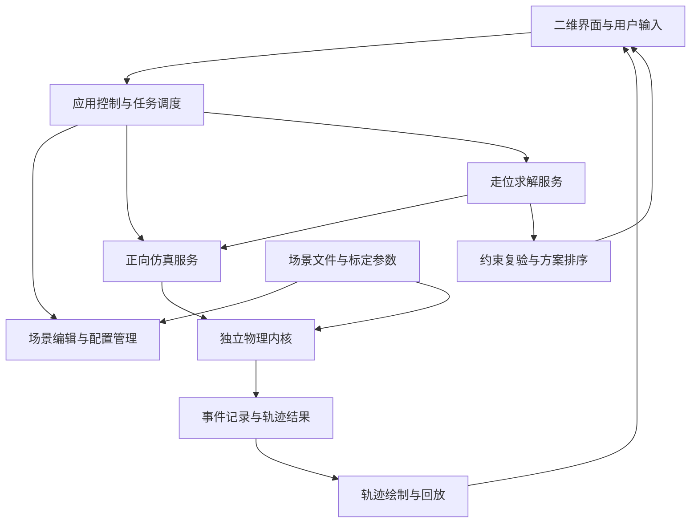

# 二维台球模拟与走位反算：软件框架设计

版本：方案草案 v0.1  
日期：2026-10-19  
本文只设计产品、架构、数据及计算流程，不包含程序实现。

## 1. 产品目标与边界

软件提供两条相互配合的使用流程：

1. **正向打球**：摆放球的位置，选择瞄准方向、杆头击点及力度，模拟整杆运动并回放。
2. **反向走位**：指定白球、目标球、白球期望停球区域，以及可选的目标球入袋、碰库等条件，计算若干可行的出杆方案。

初期按本地单机桌面应用设计，以物理模拟和练习为核心。采用一个可配置的六袋台球桌作为起点；球桌尺寸、球径、袋口与材质参数由配置决定。中式台球、美式台球、斯诺克需要不同配置，不应只是替换背景图片。

初期支持平面运动、滑动与滚动、高低杆、左右塞、球球碰撞、球库碰撞及简化进袋。暂不纳入跳球、扎杆、大角度抬杆、完整比赛裁判、联网对战和真实球桌视频识别。复杂球堆及袋角接触作为后续精度升级项，不能默认具有与普通单碰撞相同的精度。

**二维是显示与球心运动的限制，不是将球简化成没有旋转的圆盘。** 球心在台面上运动，但每个球保留三维角速度。否则无法统一解释拉杆、跟进、侧旋和碰库后走向。[物理建模参考](https://ekiefl.github.io/2020/04/24/pooltool-theory/)

## 2. 产品交互

### 2.1 界面区域

| 区域 | 内容与用途 |
| --- | --- |
| 中央球桌 | 二维俯视台面；摆球、瞄准、选球、标记停点区域、查看轨迹 |
| 击球面板 | 白球正面击点圆盘、瞄准角度、力度、实际模型参数及模型适用范围 |
| 走位面板 | 目标球、可选目标袋、停点半径、允许碰库次数、是否允许碰其他球 |
| 方案面板 | 多个候选方案；展示杆法、力度、停点偏差、事件顺序和稳定性 |
| 回放控制 | 出杆、暂停、慢放、时间轴、重新来一杆、方案比较 |

击点圆盘按“面向白球、沿出杆方向观察”的视角定义左右和上下，避免与俯视球桌的坐标方向混淆。显示合法击点范围；求解器不得推荐模型范围外或超过可击打边界的击点。

### 2.2 两种主要模式

**自由击球**：摆球 → 调整方向、击点、力度 → 预览 → 出杆 → 回放。预测辅助线可关闭，便于练习。

**走位求解**：选目标球 → 可选指定入袋 → 点击白球终点并设置容差 → 设置路线限制 → 求解 → 比较多个方案 → 应用并回放。

白球终点默认指：**整杆结束、台面运动停止后，白球球心的最终位置**。白球先停下又被其他球撞动时，仍取最终位置。求解不能把白球经过某点误认为在该点停球。初期不要求白球到达终点时还具有指定剩余速度或旋转。

终点用圆形区域表达，允许调整半径；以后可支持多边形区域。区域与球桌、球体发生冲突时，应提前提示。摆球场景本身也须检查球体重叠和越界。

## 3. 总体架构

关键约束：**手动击球、预览、走位求解和回放必须基于同一套物理模型。** 不能给求解器另写一套简化运动规则，最后用不同规则播放。

| 模块 | 责任 | 不应承担的工作 |
| --- | --- | --- |
| 界面与渲染 | 操作、绘制、参数展示、时间轴 | 不直接修改速度来制造杆法效果 |
| 应用控制 | 管理编辑/瞄准/求解/播放状态、取消任务、撤销 | 不包含碰撞公式 |
| 场景与配置 | 球桌几何、球的位置、材质、文件读写 | 不决定推荐杆法 |
| 击球模型 | 把可执行出杆参数转换成白球初始速度与旋转 | 不绕过后续物理演化 |
| 物理内核 | 运动推进、碰撞、状态转移、进袋、停止 | 不依赖界面或显示帧率 |
| 走位求解 | 候选生成、调用仿真、筛选和优化 | 不直接画出“理想轨迹”作为答案 |
| 结果与回放 | 保存事件和轨迹，按时间采样、比较方案 | 不重新执行不一致的物理计算 |
| 标定与验证 | 管理实验数据、参数拟合、误差统计 | 不把视觉效果当作精度证明 |

## 4. 核心数据与接口契约

| 对象 | 核心字段 |
| --- | --- |
| TableSpec | 台面尺寸、库边线段/圆弧、袋口和袋角几何、球桌配置版本 |
| BallSpec | 质量、半径、转动惯量、材质类别 |
| BallState | 编号、球心位置 x/y、速度 vx/vy、角速度 ωx/ωy/ωz、运动状态、是否入袋 |
| CueSpec | 有效质量、皮头接触模型、合法击点范围、力度标定关系 |
| ShotInput | 瞄准角、杆头速度、横向击点、纵向击点；抬杆角预留，初期固定 |
| PhysicsProfile | 滑动摩擦、滚动阻力、自旋衰减、球球/球库恢复和摩擦参数、参数版本 |
| SceneSnapshot | 球桌、全部球状态、物理与球杆配置引用、场景版本 |
| GoalSpec | 首次接触对象、可选入袋要求、白球终点区域、允许事件、求解预算 |
| SimulationResult | 最终状态、时间戳事件、可回放轨迹、终止原因、数值异常标记 |
| Solution | 出杆参数、完整仿真结果、约束满足情况、停点误差、扰动敏感性、求解状态 |

内部统一使用米、秒、千克、弧度；界面可显示毫米、角度和百分比。屏幕像素只在显示层换算。

核心对外提供四类能力：**模拟一杆、查询某时刻状态、求解走位、校验与保存场景**。输入为完整快照，输出为独立结果；批量求解不能污染用户正在编辑的球桌。

场景及结果保存为带版本号的 JSON。复现一杆需保存出杆参数、物理模型及参数版本、初始场景和必要的随机种子；方案还应保存求解预算。更改场景后，旧后台任务的结果不得覆盖新场景。

## 5. 物理内核

### 5.1 分层模型

**球杆击球 → 台面运动 → 接触事件 → 再运动 → 整杆结束。**

高杆、低杆和左右塞由击点与出杆参数产生初始旋转，再由接触和摩擦演化。不能用“碰撞后人为给白球加一个反向速度”代替低杆。

面向用户的“力度”可用百分比，但内部宜使用杆头接触前速度，通过击球模型转换成白球速度和旋转。百分比只在当前球杆和配置中有意义；若以后指导真人击球，需要额外标定。

### 5.2 运动与旋转

台面设为 xy 平面，z 向上。球与台呢接触点的相对速度为：

**u = v + ω × (−R ez)**。

滑动时，摩擦反对接触点的相对滑动，并同时改变平动和旋转。接触点滑动接近零后切换到滚动模型。滚动阻力和绕竖直轴的自旋衰减单独处理；侧旋可以与滑动或滚动共存，不应只用互斥的单个“旋转状态”表达所有情况。

| 效果 | 需要的机制 |
| --- | --- |
| 跟进与拉杆 | 撞球前剩余的上/下旋、碰后球与台呢的相互作用 |
| 定杆 | 撞球时的速度与旋转状态；它不是某个固定击点必然产生的结果 |
| 左右塞 | 侧旋、接触切向摩擦、碰库后速度与旋转变化 |
| 薄厚球走向 | 实际接触法线、动量交换，进一步加入摩擦引起的偏移 |
| 击球初始偏转 | 单独的球杆/皮头与白球接触模型及标定 |
| 弧线 | 与旋转轴及抬杆有关；初期不作为完整支持功能 |

在理想水平台面与水平出杆模型中，不能因为存在左右塞，就给自由运动的白球随意添加横向弯曲。真实的出杆偏转、后续弧线、球球摩擦偏移和碰库改向是不同效应，应分别建模。[旋转与轨迹参考](https://ekiefl.github.io/2020/04/24/pooltool-theory/)

### 5.3 接触与进袋

- 球球碰撞：先实现法向冲量和恢复系数，再升级切向摩擦与旋转耦合；模型可替换。
- 球库碰撞：单独考虑库边几何、恢复、摩擦与旋转影响；不能一直采用简单镜面反射。
- 球袋：以袋口、袋角、入口方向和捕获条件判断简化进袋，不是球心碰到一个大圆就立即消失。二维模型不能完整还原袋口处的三维掉落，应标明近似范围。
- 近同时碰撞：按时间容差识别接触组，使用一致的接触处理策略；单纯按球编号依次碰撞可能引入结果偏差。

碰撞模型使用统一接口，避免更换球库模型时重写求解器。[可替换物理模型参考](https://pooltool.readthedocs.io/en/latest/autoapi/pooltool/physics/index.html)

### 5.4 时间推进

建议采用**分段运动模型 + 事件驱动推进**：预测下一次球球接触、碰库、进袋或滑动转滚动的时间，推进到该事件，处理后继续。

渲染层根据物理模型采样轨迹；画面刷新率不决定物理时间步。现有 pooltool 也采用事件式演化，并由事件状态生成显示所需轨迹，可作为架构参考与对照工具。[事件演化参考](https://pooltool.readthedocs.io/en/stable/autoapi/pooltool/index.html)

对暂不适合解析推进的局部接触，预留受控数值积分与接触处理接口。无论采用哪种策略，都必须处理高速穿透、初始微小重叠、时间容差、重复零时间事件和最大事件数。达到计算上限或发生数值异常时，返回明确状态，不能把未结束的轨迹当作最终停点。

## 6. 走位反算

### 6.1 问题定义

设场景为 S，物理配置为 P，出杆参数为：

**q =（瞄准角、杆头速度、横向击点、纵向击点）**。

正向模拟 F(S, P, q) 产生整杆结果。反算寻找满足约束、且白球最终球心接近期望区域的一组或多组 q。

只指定白球终点通常不足以确定唯一方案。产品应支持两种任务：

1. **触球走位**：首次击中指定球，白球最终停在目标区域；不要求目标球入袋。
2. **进球走位**：指定目标球入指定袋，同时满足白球停点要求。

可选约束包括：允许碰库次数、允许接触的其他球、目标球速度范围、禁区、禁止白球落袋等。无需一开始实现全部，但数据结构应能表达。

### 6.2 求解流程

1. **检查场景与目标**：排除重叠、非法终点和明显违反当前模型的要求。
2. **生成候选路线**：如直接接触、一库走位、两库走位；进球任务先用目标球至袋口的几何关系生成瞄准初值。
3. **粗搜索**：在合法击点、力度和角度范围内采样，批量调用正向仿真；不遗漏阶段允许的路线类别。
4. **可行性筛选**：检查首次触球、进袋、白球存活、碰库等要求。几何初值仅用于缩小搜索，不能替代实际碰撞仿真。
5. **局部优化**：对较优候选继续调整方向、速度和击点，减少停点误差。
6. **最终复验**：使用正式物理配置完整模拟，重新检查全部硬约束及终止状态。
7. **稳定性评估**：对少量入选方案施加角度、力度和击点扰动，比较结果分布。
8. **返回不同方案**：合并几乎相同的结果，优先展示若干路线或杆法具有差异的方案。

碰撞序列变化会使目标函数不光滑。建议先使用采样/多起点与无导数优化，评估差分进化等方法；不将单一梯度下降作为求解基础。SciPy 提供带边界、约束及并行能力的差分进化接口，但具体算法应通过台球场景基准比较后决定。[SciPy 官方说明](https://docs.scipy.org/doc/scipy/reference/generated/scipy.optimize.differential_evolution.html)

### 6.3 评分与硬约束

先检查硬约束，再对合格方案排序。目标球进袋、首次接触对象正确、白球未落袋等条件不能仅用可被停点误差抵消的弱罚分表示。

合格方案的排序综合考虑：白球到目标区域的距离、瞄准/力度扰动下的失败比例、击点是否过于极端、力度大小和路线复杂程度。可用目标圆心距离进行区域内部的次级排序。

稳定性比例只能解释为**指定模型和指定扰动假设下的仿真通过比例**，不能直接称为真人进球成功率。也不应在未标定前宣称毫米级现实精度。

结果状态至少包括：找到满足容差的方案、只找到近似方案、预算内未找到、已证明某项约束冲突、模型不支持、仿真异常。搜索未找到不等于证明物理上不可达。

## 7. 技术选型建议

首个原型建议采用 **Python + PySide6 桌面界面 + NumPy/SciPy 计算生态**，优先验证物理与反算。

- PySide6 的 QGraphicsView 提供二维场景展示和交互能力，适合先搭建可编辑的俯视球桌。[Qt 官方文档](https://doc.qt.io/qtforpython-6/PySide6/QtWidgets/QGraphicsView.html)
- 物理内核为独立计算包；优化器与界面只通过数据契约调用。
- 耗时求解放在后台进程，支持取消、预算限制、阶段性候选返回；界面线程只做交互与绘制。
- 先进行批量仿真基准测试，再决定是否用编译扩展、缓存或原生代码优化热点。不能预设纯 Python 一定满足复杂全桌搜索的交互速度。
- 本地 JSON 保存场景和配置；有大量练习记录后再考虑 SQLite。

pooltool 值得作为技术验证候选及对照实现：它提供球桌、球、球杆、仿真与可替换碰撞模型。是否复用，应先验证目标桌型、杆法、袋口、性能及项目依赖；即便复用也通过物理适配层接入，避免产品直接依赖其内部对象。[项目源码](https://github.com/ekiefl/pooltool)

若后续明确需要浏览器访问，可更换界面并将计算服务部署到本地或服务器。当前不为尚未确认的多人协作引入网络后端。

## 8. 分阶段实施与验收

| 阶段 | 交付范围 | 验收重点 |
| --- | --- | --- |
| A：物理验证 | 无界面单球运动、简单球球和球库接触、事件轨迹 | 解析基准、速度与旋转耦合、停止与高速接触可靠 |
| B：二维可玩原型 | 摆球、瞄准、力度、击点、高低杆、基本碰库/进袋、回放 | 一杆可完整执行并复现，界面刷新率不影响结果 |
| C：旋转与桌面精度 | 左右塞、球球切向摩擦、球库旋转耦合、可标定参数 | 典型跟进/拉杆/定杆及侧旋碰库行为符合参考数据；标明简化效果 |
| D：基础走位反算 | 单目标球、直击、白球停点区域；支持可选进袋要求 | 所有推荐参数通过同引擎复验；显示偏差、未找到和取消状态 |
| E：扩展走位 | 一库/多库、障碍球、多解、扰动评估 | 复杂路线约束有效，候选具有差异，求解性能可测量 |
| F：训练产品 | 练习题、方案对比、配置管理及桌型标定 | 实测误差和适用范围明确，存档可复现 |

第一个具有辨识度的演示应是：**一颗白球、一颗目标球、一个可拖动的白球停球区域，软件给出可执行的击球方案并播放完整结果。** 不必等完整比赛规则做完再验证核心价值。

## 9. 验证与性能

验证按以下层次推进：

- 解析与理想基准：无外力理想碰撞的动量与能量，单球纯滚动停止距离，滑动转滚动时间。
- 物理一致性：被动接触与摩擦不产生总机械能；平动能可以由旋转能转入，不能只看球速是否增大。
- 典型杆法：不同距离和速度下的跟进、拉杆、定杆，以及左右塞碰库后走向。
- 数值稳定性：高速薄碰、贴库、极低速、球堆接触、相同输入复现、不同显示刷新率一致。
- 求解闭环：对每个推荐方案完整重放，逐项验证触球、进球、停点容差及整杆正常结束。
- 实验标定：用真实桌面上的单球减速、碰库和旋转样本拟合参数，使用独立样本评价误差。

其他模拟器可以帮助发现实现差异，但不能作为真实物理的唯一标准。先测定单杆计算耗时、每秒候选数量、求解耗时分布、停点误差和扰动通过比例，再承诺响应速度与精度。动画流畅和批量求解速度应分别验收。

## 10. 下一步需确定的产品参数

本方案暂按“本地桌面练习工具、可配置六袋球桌、优先物理与走位”推进。进入实现前需明确：

1. 首个桌型：中式、美式还是斯诺克，以确定球桌、球、袋口及标定数据。
2. 首个走位任务：只要求击中目标球，还是必须进指定袋；框架支持两者。
3. 精度定位：以虚拟练习为主，还是对特定真实球桌做标定指导。
4. 分发方式：先本地桌面验证，还是从第一版就要求网页访问。

这些选择影响默认配置和投入顺序，不改变“独立物理内核 + 同模型走位反算”的主体结构。

## 11. 已确认的实施约束（2026-10-19）

- 用户确认首个产品以中式八球为基准，并要求核实台面、球径、袋口大小及弧度。
- 当前默认采用 CBSA 2017 已公布的内沿 2540 × 1270 mm、球径 57.15 mm；WPA Heyball 2025/乔氏 1260 mm 宽台型作为独立配置保留。
- 器材依据和袋口曲线待核实项见 `docs/中八器材规格核查.md`，阶段 A 不将未知曲线填成猜测的标准半径。
- 每完成一个阶段先自行验收，再提交用户验收；阶段 A 验收前不进入阶段 B。

## 12. 第二阶段实施决定（2026-10-20）

用户确认第一阶段通过，授权进入 B。继续沿用已可打开的本地浏览器交互方式：界面采用 HTML/Canvas，本机 Python 服务调用独立物理包。先不安装 PySide6 或制作桌面安装包；这一选择不改变同内核预览、出杆和后续反算的结构。

B 的默认台面改用乔氏公开台型 2540 × 1260 mm，阶段 A 的矩形实验保留原参数。六袋、圆弧袋角和落袋线采用独立的试验配置，与已核实的台面及球径分开记录。未取得乔氏袋口图纸和利百文实测摩擦数据前，不声称实现真实乔氏袋形或实桌精度。

阶段 B 交付摆球、杆头冲量与击点输入、完整单杆、六袋捕获、回放及版本化场景存档；不包含完整球堆开球、比赛裁判或走位反算。模型精度推进仍按 C/F 的标定工作进行，走位反算按 D 进行。实施与自验见 `docs/第二阶段实施与验收.md`、`docs/第二阶段验收报告.md`；用户验收前不进入下一阶段。
